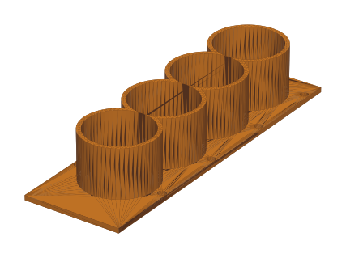
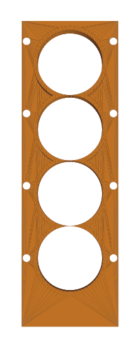

# KUKA KR10 pick-and-place: cutting cycle time without speeding up

A group practical from MEEN41350 Introduction to Robotics (MEngSc Robotics and Intelligent Manufacturing, University College Dublin, November 2026).

We programmed a KUKA KR10 to pick and place four bottles, then reworked the path so the same job ran **2.1 s faster at the same speed setting (−3.2%)**.



## The task

- Robot: KUKA KR10, six-axis industrial arm
- Programming: KRL on the KUKA smartPAD teach pendant
- Cycle: start at home, pick and place 4 bottles one by one, return home
- Programs: `GROUP112026` (baseline) and `GROUP112026OPT` (optimised)

The original brief was to reduce energy use. The energy measurement setup (DAQ with current and voltage sensors) wasn't available on the day, so we compared cycle time instead, as the brief allowed.

## My part

- Designed, programmed and optimised the robot path on the teach pendant
- Designed the bottle holder in Autodesk Fusion 360 (CAD in this repo)

## What was wrong with the baseline

- Approach and retract points sat higher and further from the bottles than needed
- The arm made near-stops between points
- One axis kept rotating back and forth for no reason
- The travel between pick and drop was longer than it had to be

## What we changed

- Moved the approach and retract points as close to the bottles as was safe
- Re-placed the via points so the arm moves smoothly between them
- Removed the wasted axis rotation
- Shortened the pick-to-drop path and the return to the next pick

Speed settings stayed the same as the baseline, so the only difference between the two programs is the path.

## Results

Cycle time measured home to home with a stopwatch (about ±0.2 s).

| Run | Speed (program override) | Cycle time | vs baseline 100% |
|---|---|---|---|
| Baseline | 50% | 130.33 s | +94.9% |
| Baseline | 75% | 69.99 s | +4.7% |
| Baseline | 100% | 66.88 s | reference |
| **Optimised** | **100%** | **64.76 s** | **−3.2%** |

Two things stand out:

1. **Path changes alone saved 2.1 s.** That's about two-thirds of what the jump from 75% to 100% speed gave (3.1 s), without running the robot any faster.
2. **Speed gains flatten out.** Going from 50% to 75% saved about 60 s. Going from 75% to 100% saved only 3 s. Past that point, the path is the lever left.

## Limits and next steps

- Energy wasn't measured. A shorter cycle usually means less energy per part, but here that's a likely benefit, not a result.
- We're not sure the 50% run was in T2 mode (T1 caps speed at 250 mm/s), so treat that number as indicative.
- Per-move velocities were left at the baseline values. Raising them to 100% on the optimised path would cut the time further.
- Next time: log cycle time inside the program with the controller timer (`$TIMER`) instead of a stopwatch.
- The KRL program files stayed on the lab controller, so they aren't included here.

## Bottle holder (CAD)

Designed in Autodesk Fusion 360 to hold the four bottles in fixed positions so the robot picks from the same spot every cycle.

| | |
|---|---|
| Overall size | 190 × 60 × 33 mm |
| Base plate | 3 mm thick, 8 mounting holes |
| Holders | 4 cups, 30 mm tall, 42.5 mm apart |



Files:
- `cad/Bottle_Holder_Robotics_Lab.step`: for opening in any CAD tool
- `cad/Bottle_Holder_Robotics_Lab.stl`: ready for 3D printing

## Repo layout

```
cad/       STEP and STL files for the bottle holder
images/    renders of the holder
README.md  this file
```

Group 11, MEEN41350, UCD. Write-up and CAD by Chandan Naveen.
